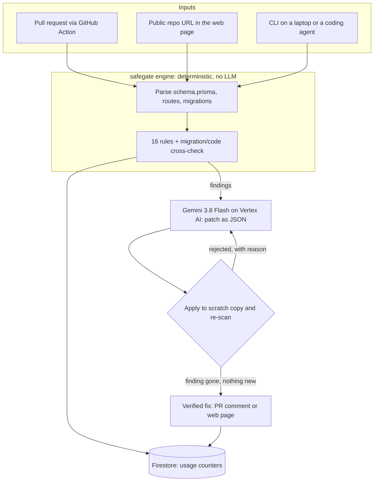

# safegate: submission pack for Startup Buildathon India 2026

Organised by Google DeepMind and Google Cloud with Hack2skill. Dates from <https://startupbuildathon.com> (checked 10 Nov 2026): **applications close 13 Nov**, city buildathons 20–21 Nov, regional showcases 23/25/27 Nov, finale 2 Dec at Google Bengaluru. The application asks for your **idea, solution, architecture and pitch deck**.

> **Check one rule before you apply.** The site says "Build a new product with Google AI" and frames the event as "idea on day one, working product on day two". It does not say whether code written before the event is allowed. Email the organisers (address in the site's FAQ) and state plainly in your application what already exists. Section 11 lists what to build during the two days so the weekend's work is clearly new.

---

## 1. One line

**safegate catches the access-control bugs and dangerous database migrations that AI coding tools write, gets a fix from Gemini, and proves the fix works before a developer ever sees it.**

## 2. Problem

AI now writes a large share of new code, and it fails in predictable places.

| Evidence | Source |
|---|---|
| About 38% of AI-generated code samples still contain vulnerabilities | Veracode GenAI Code Security Report, Oct 2026 |
| The most common critical class in AI-built apps is API authorization and business-logic failure | Cloud Security Alliance research note, Apr 2026 |
| 66% of developers say their top frustration is AI answers that are "almost right" | Stack Overflow Developer Survey 2025 |
| 35 CVEs in one month traced to AI coding tools | Georgia Tech Vibe Security Radar, Mar 2026, via CSA |

Two failures hurt small teams most:

1. **Broken access control.** `prisma.invoice.delete({ where: { id } })` works in every demo, and lets any signed-in user delete anyone's invoice.
2. **Migrations that pass on a laptop and break production.** An index build that blocks writes, a required column that fails the deploy, a "rename" that Prisma turns into drop + add and erases the data. On Postgres 16 with 300,000 rows, our proof script reproduces each of these.

Reviewers skim AI-written diffs, and general scanners match code patterns without knowing which tables belong to which user.

## 3. Solution

A three-step loop that runs on every pull request, or on any public repo pasted into the web page.

1. **Detect (deterministic).** A rule engine reads `schema.prisma` to learn which models belong to a user, then checks every route, server action and migration. 16 rules, plus a cross-check between migrations and the code that still uses a dropped column.
2. **Fix (Gemini).** For each finding, Gemini 3.8 Flash receives the rule, the file and the schema, and returns a patch as structured JSON.
3. **Prove (deterministic).** safegate applies the patch to a scratch copy and re-scans. The patch is shown only if it applies cleanly, still parses, removes the finding and adds no new one. A rejected patch goes back to Gemini with the reason, up to three attempts.

The developer gets a finding, a plain-language explanation, and a diff marked **Verified**.

## 4. What is different

Structural differences, which hold whatever features competitors add:

| | AI review bots | General SAST scanners | SQL migration linters | **safegate** |
|---|---|---|---|---|
| Finds issues with | An LLM reading the diff | Code patterns | SQL patterns | Rules that read the Prisma schema, routes and migrations together |
| Same input, same result | No | Yes | Yes | **Yes** (detection uses no LLM) |
| Knows which rows belong to which user | Sometimes, by inference | No | n/a | **Yes, from the schema** |
| Migration ↔ code cross-check | No | No | No | **Yes** |
| AI fix is machine-checked before it is shown | No | Varies | No fix | **Yes, by re-scan** |
| Setup | Install an app | Configure rules | Wire into CI | **Paste a URL, or one workflow file** |

Before pitching, spend an hour confirming the first three columns against the current product pages of CodeRabbit, GitHub Copilot code review, Semgrep, Snyk and Squawk. Their features change monthly, and several now offer AI autofix. The claim to defend is narrow: **the detector is deterministic, and no AI fix is shown unless the detector passes it.**

**Why this is hard to copy quickly:** the rule set and its false-positive test suite grow with every repo scanned, and the verify loop needs a deterministic detector to verify against.

## 5. Use of Google AI and Google Cloud

| Layer | Google product | Role |
|---|---|---|
| Fix generation | Gemini 3.8 Flash (fallback 3.6 Flash) | Writes patches with a JSON response schema; gets the rejection reason on retry |
| Model serving | Vertex AI | IAM-authenticated calls from Cloud Run, no stored key |
| Developer access | Google AI Studio key | CLI and GitHub Action use `GEMINI_API_KEY` |
| Hosting | Cloud Run | Web scanner, scales to zero |
| Data | Firestore | Atomic usage counters; no code or repo names stored |
| Build | Cloud Build, Artifact Registry | `gcloud run deploy --source` |
| Agents | Agent skill (`skills/safegate/SKILL.md`) | Lets a coding agent such as Antigravity run safegate on its own work. Written in the open SKILL.md format; confirm the format Antigravity expects. |

Gemini is in the core loop: without it there is detection but no fix. Roadmap uses that deepen this: Gemini's long context to infer ownership for models with no owner field (`Comment → Post → User`); Gemma running in a customer's own environment for teams whose code may not leave it; BigQuery for cross-customer rule analytics.

## 6. Architecture

- **Runtime:** one Node.js 22 container on Cloud Run. One dependency (`typescript`, used as a parser). Gemini and Firestore are called over REST.
- **Safety of the web scanner:** GitHub-only URLs, 80 MB archive cap, symlinks removed, repo-supplied config ignored, nothing from the repo is executed, per-IP rate limits, files deleted within 20 minutes.
- **Scale path:** scans are CPU-only and take seconds; fixes are I/O-bound Gemini calls. Next step is snapshots in Cloud Storage so any instance can verify a fix (see `docs/DEPLOY.md`).

## 7. Business model

**Open core.** The CLI, rules and GitHub Action stay MIT-licensed and free. Revenue comes from the hosted product.

| Plan | Price | Who | What they get |
|---|---|---|---|
| Free | ₹0 | Open source, solo developers | CLI, Action, web scan of public repos, limited Gemini fixes per month |
| Team | ₹999 in India, $12 elsewhere, per developer per month | Startups with 3–30 developers | GitHub App for private repos, verified fixes on every PR, dashboard, Slack alerts |
| Business | ₹1,999 in India, $25 elsewhere, per developer per month | 30+ developers | Org-wide policies, audit log of suppressions, SSO, compliance reports, lock-time estimates from real table sizes |
| Audit | ₹25,000–75,000 per project | Agencies, teams before a launch or fundraise | One-time scan, reviewed findings, verified patches, report |

Reference points (list prices, Oct–Nov 2026): CodeRabbit from $24, Snyk Team $25, Semgrep Teams about $30 per developer per month. safegate prices below them as a specialist that sits alongside them.

**Unit economics to measure during the buildathon:** tokens per fix (one file plus the schema in, a small JSON patch out, at most three attempts) × the current Gemini 3.8 Flash price = cost per verified fix. Detection costs almost nothing: no LLM, about 3 seconds for 5,000 files. Put the measured number on the slide; do not estimate it.

**Illustrative target, not a forecast:** 40 teams × 8 developers × $12 ≈ $3,800 a month.

## 8. Market and go-to-market

- **First customer:** a startup with 2–30 developers on Next.js or Express + Prisma + Postgres, using AI coding tools, with no security engineer.
- **Why India first:** rupee pricing, reachable founders, and a dense base of agencies building this stack for clients.
- **Channels:**
  1. Scan open-source Prisma apps, report issues privately to maintainers, publish the patterns found. This is the launch content.
  2. The free web scanner as the top of the funnel: paste a URL, see findings in seconds.
  3. GitHub Marketplace listing for the Action.
  4. Direct outreach to CTOs of companies hiring for Prisma, with a free scan.
  5. Paid audits for agencies, which fund the first months.
- **Expansion:** Drizzle and TypeORM, tRPC and GraphQL, MySQL, then Python (FastAPI + SQLAlchemy).

Do not quote a market-size figure you cannot source. If the deck needs one, use a named analyst report and cite it on the slide.

## 9. Founder profile (criterion 01: you must write this)

Answer in your own words, three or four sentences each:

- What have you built or run in production? Have you seen a bad migration or an access bug first hand?
- Why this problem, and why are you the person to solve it?
- What have you already done? (Working engine, 50 automated tests, web service, the Postgres proof.)
- Who else is on the team, or who are you looking for?

## 10. Three-minute demo

| Time | Show | Say |
|---|---|---|
| 0:00 | An AI tool writing a delete endpoint | "This works in every demo. It also lets any user delete anyone's data." |
| 0:25 | Web page → **Try the demo app** → 17 findings | "No LLM here. Same code, same result, every time." |
| 0:55 | `AUTH003` → **Fix with Gemini** → Verified diff | "Gemini wrote this patch. safegate applied it, re-scanned, and only then showed it." |
| 1:30 | A migration finding (`MIG009`, the lossy rename) and its fix | "Prisma turned a rename into drop and add. On real Postgres that erased 300,000 values." |
| 2:00 | A pull request with inline annotations and the fixes comment | "One workflow file. This is where teams use it daily." |
| 2:30 | Pricing slide | "Free and open source at the core. Teams pay for private repos and verified fixes on every PR." |

Have a screen recording ready in case the network fails.

## 11. What to build at the city buildathon (20–21 Nov)

Pick work that is new, visible, and deepens the Google AI use:

1. **GitHub App** on Cloud Run: install on a private repo, get verified fixes as one-click PR suggestions.
2. **Snapshots in Cloud Storage** so Cloud Run can scale past one instance.
3. **Gemini ownership inference:** let Gemini read the schema and propose owner chains for models without an owner field, which the engine then enforces deterministically.
4. **Run live against real Gemini** and record acceptance rate (verified fixes ÷ fixes requested) and cost per fix. Put both numbers in the deck.
5. **Accuracy numbers** from 5 real open-source repos (`VALIDATION.md`, stage 6).

## 12. Pitch deck outline (10 slides)

1. Title, one line, your name
2. Problem: the two failures, with the sourced numbers from section 2
3. Why now: AI writes the code, review cannot keep up
4. Solution: detect → fix → prove
5. Live demo
6. What is different (section 4 table, trimmed)
7. Google AI and Cloud architecture
8. Business model and pricing
9. Traction and proof: tests, Postgres proof, real-repo accuracy, any users
10. Founder, roadmap, the ask

## 13. Honest status (10 Nov 2026)

| Works and is tested | Not yet tested or built |
|---|---|
| Detection engine, 16 rules, 50 automated tests | Calls to the real Gemini API (tested against a stand-in server with the documented request shape) |
| Verify loop: bad patches rejected, good one accepted | Deployment to a real Cloud Run project and Firestore |
| Web service and page, checked in a browser | Container build (no Docker daemon in the build environment) |
| Postgres 16 proof of the migration risks | Accuracy on real-world repositories |
| PR mode on a simulated pull request | GitHub Action on GitHub; GitHub App; billing |

Run `docs/DEPLOY.md` section 3 and `VALIDATION.md` stage 10 to close the first three gaps. It takes about an hour.

## Sources

- Startup Buildathon India 2026: <https://startupbuildathon.com/>
- Veracode GenAI Code Security, Oct 2026 (summary): <https://softprom.com/veracode-genai-code-security-2026>
- Cloud Security Alliance, vibe coding security debt: <https://labs.cloudsecurityalliance.org/research/csa-research-note-ai-codegen-vulnerability-debt-2026>
- Cloud Security Alliance, AI-generated CVE surge: <https://labs.cloudsecurityalliance.org/research/csa-research-note-ai-generated-code-vulnerability-surge-2026/>
- Stack Overflow Developer Survey 2025: <https://stackoverflow.blog/2025/07/29/developers-remain-willing-but-reluctant-to-use-ai-the-2025-developer-survey-results-are-here>
- Gemini models: <https://aistudio.google.com/docs/models>
- Pricing references: <https://www.coderabbit.ai/pricing>, <https://snyk.io/plans/>, Semgrep pricing page
